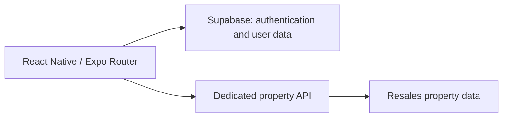

# MarbellaPortal

**A focused property discovery product for Marbella, built from product idea through application engineering.**

MarbellaPortal helps people explore Marbella properties, narrow their search, save favourites and make an enquiry. Built with React Native, Expo and TypeScript, with Supabase authentication and a dedicated property API integrating Resales data.

**Status:** Pre-launch / in active development.
**Creator and developer:** [William Eklund](https://github.com/wilek162)
**Project website:** [marbellaportal.com](https://marbellaportal.com)

This repository presents the product, the thinking behind it and a runnable example extracted from the private application. It is intended for people interested in product-focused engineering and recruiters.

## Product focus

Property search is a journey, not just a results list. Buyers need to refine their criteria, compare properties and return to an enquiry without losing their progress. MarbellaPortal focuses on one market and connects discovery with the next practical step: contacting an agent.

The application includes property search and filters, property details and galleries, favourites, account flows and enquiries. Its shared UI primitives keep typography, themes and controls consistent across screens.

## My role

I created MarbellaPortal and own its product direction and development: shaping the experience, implementing the application, integrating authentication and property data, and developing the testing and delivery workflow.

## Architecture



| Layer | Approach |
| --- | --- |
| Application | React Native, Expo, TypeScript and Expo Router |
| Interface | Shared themed components and reusable screen patterns |
| Identity and user data | Supabase |
| Property discovery | Dedicated API integrating Resales data |
| Quality | Vitest for deterministic logic; Jest Expo for application runtime tests |
| Delivery | Expo EAS with separate staging and candidate verification |

## Engineering example: an enquiry that survives interruption

**Problem:** An enquiry can span property browsing, contact details, email verification and an app restart. Losing it creates friction. Restoring it for another account creates a privacy problem. Retrying with a new identity for the same request can complicate duplicate prevention.

**Implementation:** Persist an expiring draft with its original request ID. Check the current identity and verified email ownership before restoring it. Keep a verified draft tied to its account. Serialise storage writes so a slow save cannot restore a cancelled draft.

**Trade-offs:** A 24-hour expiry limits how long an abandoned draft remains recoverable. The browser adapter uses tab-scoped session storage; it does not promise recovery after the browser session is closed. Storage failures are surfaced rather than silently falling back to a different persistence model.

The request ID is preserved for the submission layer. This sample does not implement server-side idempotency or prove that an enquiry email was delivered.

### Read and run the code

- [Enquiry draft recovery implementation](src/enquiry-draft-store.ts)
- [Regression tests](src/enquiry-draft-store.test.ts)
- [Standalone native storage boundary](src/large-secure-store.ts)

With Node.js 22.12 or later:

```sh
npm ci
npm run typecheck
npm test
```

The implementation and regression test files are extracted unchanged from the private app's staging source at commit `727ddc15f50436795f64eeb4aaf2a1765dfb4e18`. The native storage module is replaced with an explicitly unsupported adapter: the real app uses Expo SecureStore; the tests mock that boundary. No service credentials, live account or native build are required.

The tests cover guest restart recovery, verified email ownership, rejection of other identities, account binding, damaged and expired drafts, save/cancel ordering, and browser storage failures. The public CI workflow checks the standalone sample on each push.

## What this demonstrates

- Connecting a product requirement to concrete state and recovery behaviour.
- Handling ownership boundaries during authentication transitions.
- Addressing asynchronous write ordering and retry continuity.
- Testing failure paths with controlled storage and time inputs.
- Separating local regression checks from real service and release acceptance.

## Verification

On 26 October 2026, the standalone sample passed its TypeScript check and all 10 regression tests after a clean lockfile install. The private application also passed its mandatory TypeScript check and the corresponding 10 original draft tests. These are local automated results, not hosted or store-release acceptance.

## Scope and project status

This is a selected engineering sample, not the complete application or a public app release. It demonstrates local draft behaviour; it does not establish real authentication delivery, database ownership policies, enquiry delivery or Play-installed acceptance. The complete product includes additional screen, integration and release checks in its private repositories.

Current app screenshots and a recorded walkthrough are not included in this initial edition. The code here is real application logic, rather than a claim that a public store version is already available.

## Contact and rights

For project enquiries, use the contact options on [my GitHub profile](https://github.com/wilek162).

The application remains proprietary. This repository does not grant an open-source licence. Third-party dependencies, property data and imagery retain their respective rights.
